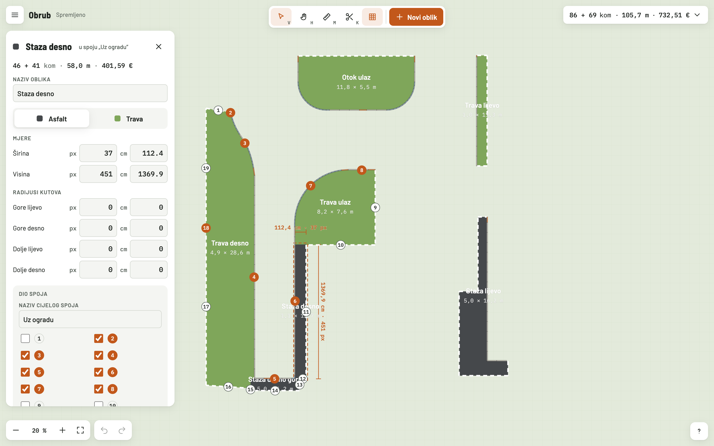
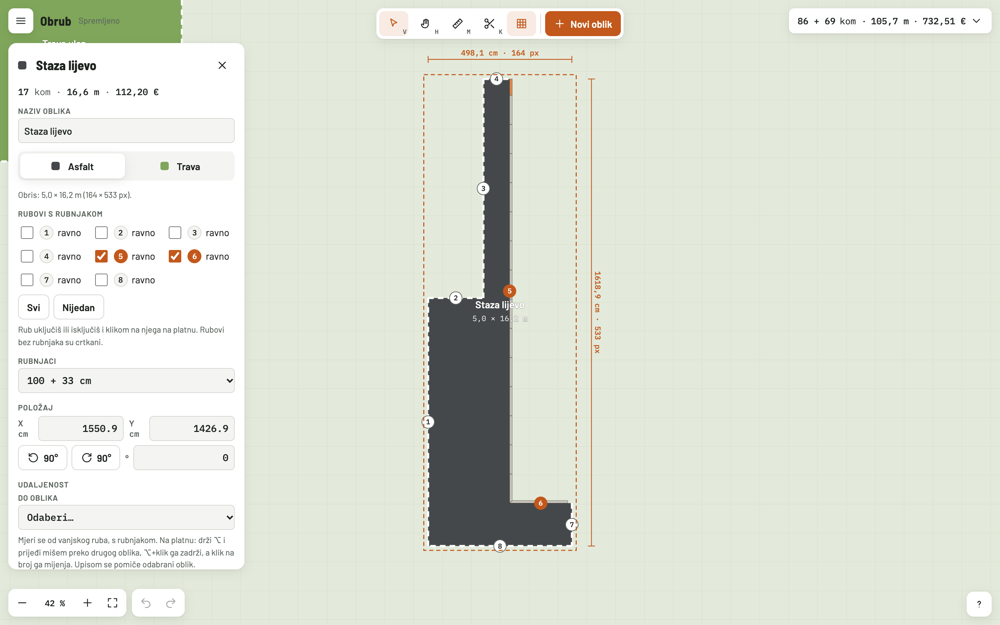
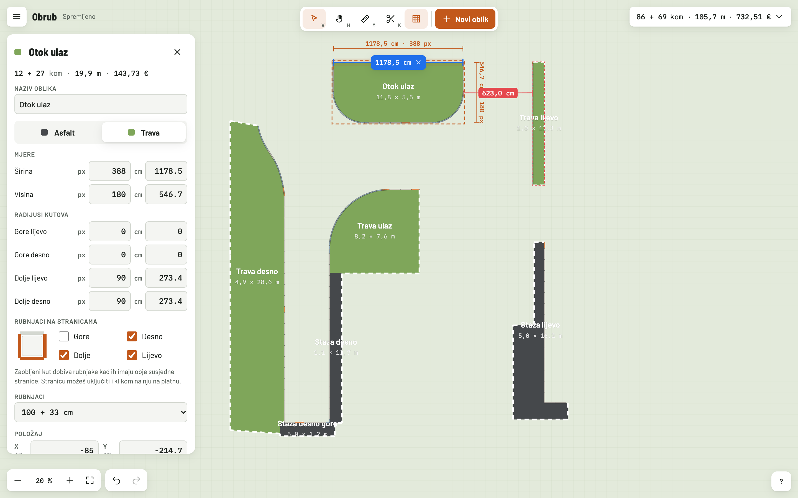
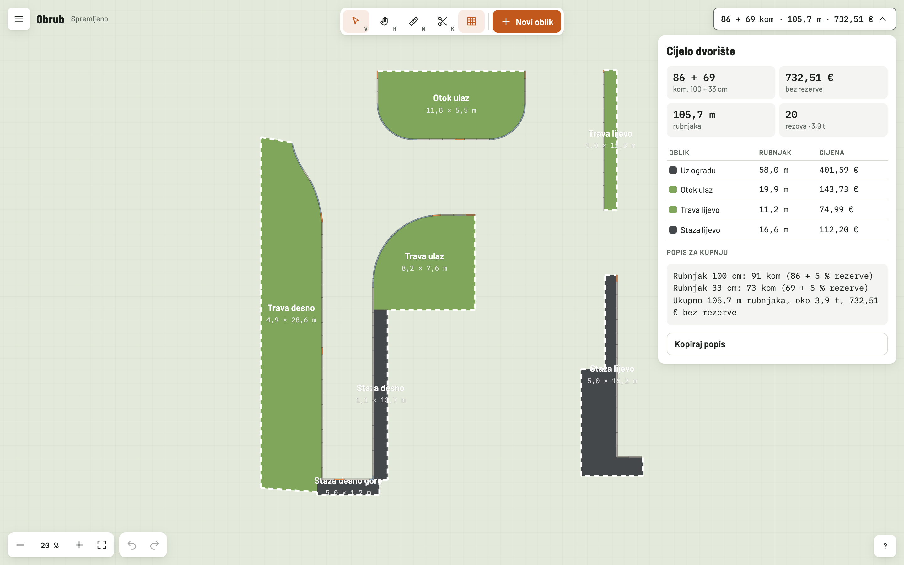
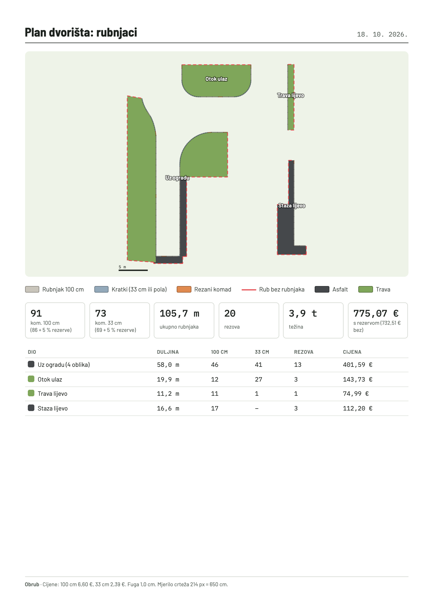
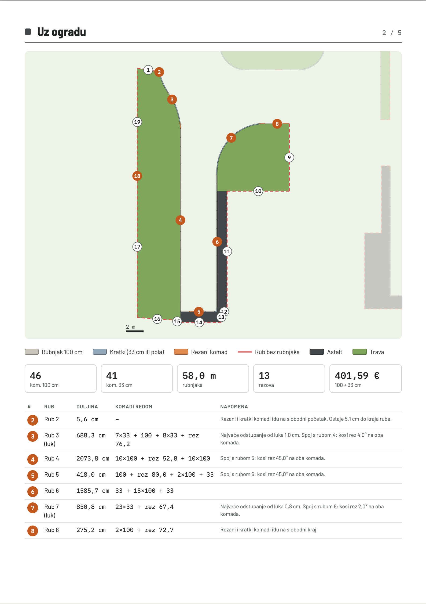
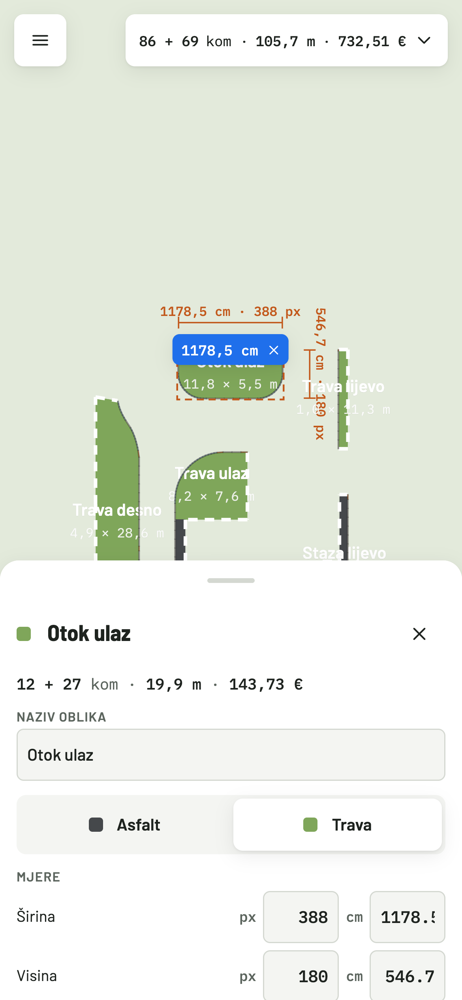

<div align="center">
  
  <h1>Obrub</h1>
  <p><strong>Planer betonskih rubnjaka za dvorište.</strong><br>
  Nacrtaj ili uvezi dijelove dvorišta, označi gdje idu rubnjaci, i dobij točno koliko komada treba, gdje se reže i koliko to košta.</p>
  <p>
    <a href="#pokretanje">Pokretanje</a> ·
    <a href="#što-zna">Što zna</a> ·
    <a href="#kako-se-računa">Kako se računa</a> ·
    <a href="#prečaci">Prečaci</a>
  </p>
</div>



## Pokretanje

```sh
pnpm install
pnpm dev          # http://localhost:6123, i na lokalnoj mreži za mobitel
```

Plan se sprema automatski u [`data/plan.json`](data/plan.json). Datoteka je u repozitoriju, pa je plan dostupan s bilo kojeg računala.

## Što zna

<table>
<tr>
<td width="50%"></td>
<td>

### Nepravilni oblici iz Photoshopa
Shape sloj izvezi kao SVG (*Export As → SVG* ili *Copy SVG*) i povuci ga na platno, ili samo zalijepi kod s <kbd>⌘V</kbd>. Svaki obris postaje oblik, podijeljen na rubove na kutovima i na prijelazima iz ravnog u luk. Klikom na rub uključuješ ili isključuješ rubnjak, a rub bez rubnjaka je crtkan.

Pravokutnici s radijusima kutova mogu se i ručno upisati, u pikselima s crteža ili u centimetrima.

</td>
</tr>
<tr>
<td>

### Spajanje, nož i ljepljivi rubovi
Dijelovi se dok ih povlačiš lijepe jedan uz drugi. Odabrane dijelove (<kbd>Shift</kbd> + klik) spojiš u jedan obris: rubnjaci tada idu samo vanjskim rubom, bez dvostrukih komada na dodiru. Nožem (<kbd>K</kbd>) presiječeš višak oblika.

</td>
<td width="50%"></td>
</tr>
<tr>
<td width="50%"></td>
<td>

### Mjerenje i popis materijala
Ravnalo (<kbd>M</kbd>) se lijepi na kutove, rubove i vanjske rubove rubnjaka. Udaljenost između dva dijela (<kbd>⌥</kbd> + klik) upišeš u centimetrima i dio se pomakne na tu udaljenost. Popis materijala zbraja sve dijelove i daje popis za kupnju s rezervom.

</td>
</tr>
<tr>
<td>

### Ispis na A4
Prva stranica je cijelo dvorište, ukupna količina i tablica po dijelovima. Uz *Detaljniji izvoz* svaki dio dobiva svoju stranicu s većim crtežom, brojevima rubova i redoslijedom komada po rubu, npr. `2×100 + rez 75,1 + 3×100 + 33`.

</td>
<td width="50%"></td>
</tr>
</table>

<details>
<summary>Detaljna stranica ispisa i izgled na mobitelu</summary>
<br>
<p align="center">
  
  &nbsp;
  
</p>
</details>

## Kako se računa

Rubnjaci su 9×20×100 i 9×20×33 cm, s fugom od 1 cm. Cijene, fuga i mjerilo crteža (npr. 214 px = 650 cm) mijenjaju se u postavkama.

- **Ravni rub između dva kuta:** što manje komada, najviše jedan rez, a rezani komad ide u sredinu.
- **Rub sa slobodnim krajem:** cijeli komadi od vezanog kraja, a ostatak ide kao jedan odrezani komad na slobodni kraj.
- **Luk:** komadi od 33 cm, a od 100 cm samo gdje bi od pravog luka odstupali manje od 1 cm. Radijus zaobljenog kuta prilagodi se tako da stanu cijeli komadi. Za svaki luk se vidi koliko odstupa i kolika je vanjska fuga.
- **Kutovi koji nisu 90°:** kosi rez na oba komada, s kutom u tablici.
- **Tri načina:** 100 + 33 cm, samo 100 cm, ili 100 cm prerezani na pola za lukove.

## Prečaci

| Tipka | Radnja | Tipka | Radnja |
|---|---|---|---|
| <kbd>V</kbd> | Odabir | <kbd>⌘Z</kbd> / <kbd>⌘⇧Z</kbd> | Poništi / ponovi |
| <kbd>H</kbd> ili razmaknica | Pomicanje pogleda | <kbd>⌘D</kbd> | Dupliciraj |
| <kbd>M</kbd> | Ravnalo | <kbd>R</kbd> / <kbd>⇧R</kbd> | Rotiraj 90° |
| <kbd>K</kbd> | Nož | Strelice | Pomakni 1 cm (s <kbd>⇧</kbd> 10 cm) |
| <kbd>N</kbd> | Novi oblik | <kbd>⇧1</kbd> / <kbd>⇧2</kbd> | Prikaži sve / odabrano |
| <kbd>⌘P</kbd> | Ispis | <kbd>?</kbd> | Svi prečaci |

## Razvoj

React, TypeScript, Vite i SVG platno, bez backenda: plan sprema mali middleware u [`vite.config.ts`](vite.config.ts). Svako spremanje ima broj verzije, pa dva otvorena prozora (npr. računalo i mobitel) ne prepisuju jedan drugoga.

```sh
pnpm typecheck
pnpm e2e          # pokreće vlastiti server na :6124 s testnim planom; tvoj plan ne dira
```

| Mapa | Sadržaj |
|---|---|
| `src/geometry.ts` | Raspored komada po rubovima, lukovi, kosi rezovi |
| `src/svgImport.ts` | Čitanje SVG obrisa i podjela na rubove |
| `src/join.ts`, `src/cut.ts` | Spajanje dijelova i nož |
| `src/components/` | Platno, paneli, ispis |
| `e2e/smoke.mjs` | Test u stvarnom pregledniku za sve gore |
